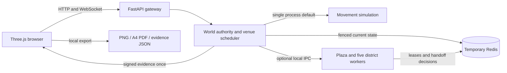

# Architecture and protocol

## One logical world

The normal path is one FastAPI application and one authoritative asyncio game
loop. `World` owns guests, consent, groups, reservations, queues, phases, movement,
and finalization. `GameServer` owns connections and cadence. Browser rendering
runs independently. Running more generic Uvicorn workers does not share memory;
an OS namespace lock and optional Redis lease reject a second authority.



The server targets 20 simulation updates/second, broadcasts nearby avatar
snapshots at approximately 10 Hz, and publishes current event/role metadata at
2 Hz. Control commands also receive a fresh authoritative state. The browser
sends normalized input periodically at 25 Hz, with immediate start/stop changes.
It simulates local walking every render frame. On a snapshot it replays the recent
input timeline over the snapshot's age, then gradually corrects positional drift
through the same collision/access map. Acknowledgements continue to identify
accepted commands; they do not represent a duration of movement. Authoritative
relocations clear prediction and the current route.

Other guests use a 150ms snapshot buffer and interpolate position and shortest
yaw. Missing data holds the last pose rather than extrapolating through walls.
The render clock uses monotonic browser time and the least-delayed recent server
clock sample, with slow drift correction. A delayed metadata message cannot
abruptly move that clock backwards. The optional `self.motionUntil` metadata is
derived from the authority's entrance and seven-step deadlines. During those
intervals the couple follows the same buffered authority poses as observers.

The collision map, district transforms, path widths, preparation walls, protected
areas, and central landmark are shared. Swept movement uses short substeps and
server speed limits. Map destinations produce an A* walking path in the client;
line-of-sight shortening removes redundant grid waypoints while checking each
segment against the access map. The server validates every step. The only automatic relocations are invitation
arrival, authoritative ceremony choreography, and access revocation to a public
point. Camera changes never move a guest or grant permissions.

Decorative foliage, seats and small props are simplified visual geometry rather
than a complete physics simulation. Buildings with no use are decorative; public
circulation is level. Every district has public routes around the ritual zone.

## Wire protocol v1

All binary integers/floats are network byte order. The server never accepts
client-supplied coordinates, roles, phase transitions or successful completion.

| Message | Layout | Bytes |
| --- | --- | --- |
| Movement input | `u8 version=1, u8 kind=1, u32 sequence, f32 dx, f32 dz, f32 yaw` | 18 |
| Snapshot header | `u8 version=1, u8 kind=2, u32 tick, f64 epochSeconds, u16 count` | 16 |
| Snapshot guest | `u32 id, f32 x, f32 z, f32 yaw, u32 ack, u8 avatar, u8 emote` | 22 per guest |

Sequences use unsigned rollover comparison; stale/superseded inputs are ignored.
Each guest holds one latest input. The superseded input counter is exposed as
`droppedMovement`; it is not a count of network packet loss. Nonfinite or oversized
values are rejected. Snapshot count is capped at 96, including the local player.

JSON control messages:

```json
{"v":1,"type":"hello","token":"temporary-tab-session-secret"}
```

```json
{"v":1,"id":"request-id","type":"ready","data":{"eventId":"temporary-id"}}
```

The welcome includes the session's identity, latest input sequence, public
verification key, and current state. Commands return `command_ok` or
`command_error` with the request ID. Server snapshots recover missed notifications;
there is no event replay log. Public codes identify invitees and are not secrets.

Guest creation also accepts `gender` (`female` or `male`) and `clothingColor`
(a validated six-digit hex color). These are temporary cosmetic fields on the
guest, included in welcome/self state and nearby JSON metadata. Binary movement
frames remain unchanged. The avatar byte selects skin/hair appearance; changing
clothing color does not alter it. Nearby models replace only their outfit
geometry, retaining their independent skeleton and active animation mixer.

Origin checks use exact allowlisted browser origins. Hello is limited to 2 KB,
JSON controls to 4 KB, the Uvicorn frame to 8 KB, incoming transport queue to 16,
all messages to 65/second and control commands to 12/second per connection.
Arrival creation has a separate IP limiter. TLS belongs at the deployment edge.

Every peer has at most 32 queued control messages and one replaceable movement
snapshot. World metadata replaces older metadata. A slow socket has a two-second
send timeout and is disconnected instead of blocking simulation. Finalization
purges event-tagged messages and pending world metadata. Interest uses a 32 m
spatial grid, a 90 m radius and a nearest-96 bound. Distant avatars hide labels
and detailed limbs. Browser pixel ratio adapts when rendering falls behind.
This does not yet implement a production bandwidth budget or dynamic per-zone
network cadence.

## Events, queues, and deletion

The local registration form is `DRAFT`. An explicit proposal becomes
`INVITE_PENDING`; it has no public wedding or invitation. The invitee's explicit
consent creates exactly one `QUEUED` event. Each district owns one Stage A and
FIFO queue. The shared authority serializes all reservations before any await.

`QUEUED → VENUE_ASSIGNED → READY_CHECK → CEREMONY_ACTIVE → COMPLETED`

Cancellation and expiry are valid terminal outcomes. Repeated consent, role
invitations and ready acknowledgements are harmless. A deleted event ID cannot
restore privileges or create a new event. Optional roles reserve finite places
while pending, and acceptance is needed for access. Parents sit closest to the
stage; a member's priority/preparation access is limited to their side. Only the
couple and currently called accepted roles enter the ritual areas. Roles freeze
while active. Revocation/finalization moves restricted occupants to public ground.

Both participants must be connected and in the ready circle when the scheduler
starts, with both confirmations before the 60-second deadline. Missing zero or
one confirmation cancels without a certificate and releases the venue for the
next queued couple. An active ceremony has a one-minute turnover. Required
actions are checked against server time, including skipped ticks; no client
command can fast-forward or claim completion. Guests who leave a required
moment unfinished do not get a certificate.

Vietnam's slot is 60 seconds ready + 480 ceremony + 60 turnover = 600 seconds.
The other programs have independent configured durations. Queue estimates assume
earlier couples use their full slots and are displayed as estimates. Alternative
free districts can be inspected; changing a district requires cancellation and
fresh mutual consent at the registrar. No advance date/time booking is implemented.

Completion creates Ed25519 evidence, enqueues it only for connected couple
browsers, revokes access, releases the venue, deletes event/slugs/groups/roles/
queue references, and flushes the current aggregate. Evidence is never stored
for retrieval or held for a download acknowledgement. Only the venue cooldown
and unrelated temporary guest sessions survive. The browser retains already
received evidence in memory and lets the guest deliberately download it.

Redis stores only the current event aggregate with a 180-second refreshed crash
TTL. A compare-token lease plus monotonic revision fencing prevents an expired
owner or delayed old save from recreating deleted state. Concurrent saves repeat
until the current revision is durable before returning. There are no Redis Streams,
history tables, completed-event endpoints, retries containing old ceremonies, or
per-event generated artwork. Redis Compose persistence is disabled.

On a crash, abandoned state expires; a new authority deliberately does not
restore old ceremonies. On lost coordination, movement and commands fail closed.
The gateway reports health without guest names or tokens. Logs omit HTTP access
URLs by the supplied run commands. Operators must preserve those retention choices.

## Optional process partition

`WORLD_ZONE_WORKERS=1` requires Redis and starts six **actual Python child
processes**: plaza and five districts. The gateway still owns sessions, events,
and venue scheduling. Movement is routed over local Pipes to the owning zone.
Redis handles leases, generations and presence transfer, not every motion frame.

Handoff sequence:

1. Freeze source motion at a boundary.
2. Prepare an inactive destination record.
3. Atomically compare the coordinator token and old presence owner, then commit
   the new owner in Redis.
4. Activate the destination, update the route, discard the source copy.
5. Reconcile a pending transfer before taking more input if interrupted.

Worker responses are tagged with request IDs, owner generations and guest
revisions. The parent ignores stale responses. Identity, avatar, invitation,
membership, wedding and phase stay in the central aggregate through handoff.
Tests spawn six independent processes against a TCP Redis emulator and inject
an interruption after the atomic owner change. No test assumes shared Python
memory.

This mode is an experimental one-host partition. It has a central gateway and
event coordinator, bounded local RPC and no automatic failed-zone replacement.
Worker/coordination failure pauses the world; it does not silently run duplicate
ceremonies. Redis 7 container runtime, multi-host gateway routing, geographic
presence, crash failover and distributed load have not been validated here.

## Scaling work remaining

Keep detailed subscriptions local and route sessions to fenced zone owners.
Replace local IPC with authenticated cross-host transport when actually needed.
Add operational rate/bandwidth budgets, measured density thresholds, load-aware
updates, graceful admission and bounded global announcement fan-out. Expand
actual public Stage B/C compounds to increase wedding throughput; extra spectator
views observe the existing event and cannot increase ceremony throughput.

Run interaction and reconnect/transfer workloads, hot venues, long soaks and WAN
latency in progressively larger environments. A 20/100 local connection test
does not establish 1,000, 10,000 or 100,000 CCU. Those loads were not run here.
