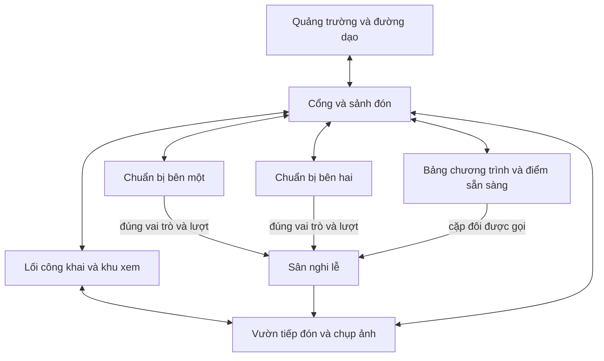

# Kế hoạch cải thiện UI UX bản đồ và animation Wedding World

Ngày nghiên cứu ban đầu: 05/11/2026. Cập nhật triển khai: 06/11/2026.
UI, model, map và chuyển động đã có đợt nâng cấp; kết quả ở mục 11.

## 1. Hướng đề xuất

Đưa Wedding World từ bản thử nghiệm chức năng thành một công viên lễ cưới có
đường đi dễ hiểu, nhân vật có sức biểu đạt và những khoảnh khắc đáng lưu lại.
Điện thoại và máy tính có mức ưu tiên ngang nhau, theo lựa chọn đã xác nhận của
chủ sản phẩm. Thiết kế bố cục và điều khiển phù hợp từng nền tảng; cả hai đều
phải hoàn thành đầy đủ các hành trình và đạt tiêu chí riêng ở mỗi đợt.

Thứ tự thực hiện: sửa khả năng đọc và thao tác; hoàn thiện một tuyến trải nghiệm
ở quảng trường và khu Việt Nam; kiểm tra người chơi và hiệu năng; sau đó mở rộng
chất lượng đã đạt sang bốn khu còn lại. Chất lượng mẫu phải bao gồm giao diện,
cảnh quan, nhân vật, chuyển động và một lễ cưới có thể chơi trọn vẹn.

Phạm vi đợt này tập trung vào trải nghiệm. Giữ nguyên Three.js/TypeScript và
Python authoritative; mọi thay đổi quyền, di chuyển hay nghi thức vẫn cần máy
chủ xác nhận. Các tiêu chí kiểm thử người chơi, điện thoại thật và đám đông dưới
đây vẫn là mục tiêu cần đánh giá; kết quả đã thực hiện được ghi riêng ở mục 11.

## 2. Những vấn đề đã quan sát

Đánh giá ban đầu ngày 05/11 dựa trên mã, ảnh kiểm thử và kiểm tra trực tiếp tại
`http://127.0.0.1:5173`, viewport 390 × 844. Đây là đánh giá thiết kế, chưa phải
kết quả nghiên cứu với người chơi mới.

| Vấn đề | Bằng chứng hiện tại | Tác động cần kiểm tra | Ưu tiên |
| --- | --- | --- | --- |
| Chữ và vùng chạm nhỏ trên điện thoại | Nút camera 30 × 31 px; cử chỉ/chụp ảnh 34 × 34 px; chọn màu avatar 20 × 20 px; chú thích camera 8 px, nút hướng đến registrar 9 px | Khó đọc và bấm chính xác, đặc biệt lúc đang điều khiển nhân vật | P0 |
| Công cụ hiện đồng thời, thiếu ưu tiên theo tình huống | Thanh camera năm nút, minimap, joystick, nút cử chỉ, ảnh và thẻ nội dung cùng xuất hiện | Người mới phải tự tìm hành động phù hợp; trên màn hình nhỏ còn ít khoảng nhìn | P0 |
| Góc nhìn đầu tiên chưa dẫn đến địa điểm có ích | Ảnh vào thế giới chủ yếu thấy mặt sân và nhân vật; bảng tên của chính mình khá lớn | Chưa biết nên đi đâu, cảm giác công viên trống dù đã có các khu | P0 |
| Bản đồ hữu ích ở mức sơ đồ kết nối | Năm nút quốc gia và các đường nối; chưa có chi tiết registrar, cổng, hàng ghế, khu chuẩn bị, điểm chụp ảnh | Khó nối thông tin bản đồ với cảnh đang nhìn và với quyền hiện tại | P1 |
| Cảnh quan còn lặp cấu trúc | Các khu dùng chung khung sân chữ nhật, ghế và nhiều hình khối cơ bản | Bản sắc giữa các khu chưa rõ ở góc nhìn người chơi | P1 |
| Chuyển động còn đơn giản | `scene.ts` lắc tay/chân bằng sin và đặt góc theo emote; đạo cụ được hiện/ẩn theo hành động | Dễ trượt chân, chuyển tư thế đột ngột; động tác trao lễ vật, nâng chén và trao nhẫn chưa đủ khác nhau | P1 |
| Thiếu nhịp diễn trong một nghi thức dài | Các đoạn 60–180 giây hiện phụ thuộc nhiều vào lời dẫn, một hành động và bộ đếm | Sau khi bấm xong, người tham gia có thể thấy thời gian chờ thiếu mục đích | P1 |

Ảnh và số đo mới: `artifacts/ux-audit/mobile-entry.png`, `mobile-hud.png`,
`mobile-map.png`, `measurements.json`. Ảnh toàn cảnh và lễ hiện tại nằm trong
`artifacts/desktop-welcome.png` và `artifacts/ceremony-live.png`.

## 3. Kết quả nghiên cứu và cách áp dụng

| Cơ sở | Điều rút ra | Quyết định cho Wedding World |
| --- | --- | --- |
| [Game Accessibility Guidelines](https://gameaccessibilityguidelines.com/full-list/) đề cập nút đủ lớn, nhắc điều khiển/mục tiêu, trợ giúp theo ngữ cảnh và dấu hiệu tương tác | Công cụ phải dễ nhận ra trong lúc chơi | Một hành động chính theo ngữ cảnh; nhãn chữ cho tác vụ quan trọng; hướng dẫn xuất hiện khi cần |
| [WCAG 2.2](https://www.w3.org/TR/WCAG22/#target-size-enhanced): tiêu chí 2.5.8 AA dùng mốc 24 px với ngoại lệ; 2.5.5 AAA dùng 44 px với ngoại lệ | Không đồng nhất 44 px với yêu cầu AA | Chọn 44–48 CSS px làm mục tiêu sản phẩm cho nút chạm; chữ nội dung 16 px; tương phản chữ thường ít nhất 4.5:1 trên nền ổn định |
| [Making the World of Firewatch, Jane Ng, GDC 2016](https://media.gdcvault.com/gdc2016/Presentations/Ng_Jane_MakingTheWorld.pdf), trang PDF 60–68 | Cần thử khoảng cách bằng trải nghiệm đại diện; địa danh giúp tổ chức không gian và hành trình | Làm một tuyến có đủ chất lượng mẫu, dùng công trình đặc trưng để dẫn hướng rồi mới nhân rộng. Đây là bài học áp dụng, không phải bằng chứng rằng cùng cách làm chắc chắn thành công ở Wedding World |
| [Tài liệu camera của Sky](https://thatgamecompany.helpshift.com/hc/en/17-sky-children-of-the-light/faq/1131-how-do-i-use-the-camera/) mô tả chế độ thường, selfie và tripod | Chụp ảnh có thể là một tương tác xã hội riêng | Đề xuất photo mode có vị trí đứng, hẹn giờ và ẩn HUD; kiểm tra độ hữu ích trong game này, không sao chép giao diện hoặc tài sản của Sky |
| [Three.js Animation System](https://threejs.org/manual/pages/animation-system.html) và [AnimationAction](https://threejs.org/docs/pages/AnimationAction.html) hỗ trợ clip, mixer và crossfade | Có thể dùng bộ xương và clip đã dựng thay cho nhiều nhánh đặt góc thủ công | Một rig dùng chung, clip GLB và chuyển trạng thái có hòa trộn; thời gian nghi thức lấy từ máy chủ |
| [Three.js InstancedMesh](https://threejs.org/docs/pages/InstancedMesh.html) dành cho vật thể dùng chung geometry/material | Đồ trang trí lặp lại có thể giảm draw call | Đánh giá instancing cho ghế, cây, đèn và hoa theo từng cụm; ngân sách rig nhân vật được đo riêng |

Các chỉ tiêu cụ thể dưới đây là mục tiêu đề xuất, chưa phải kết quả đã đạt.

## 4. Định hướng hình ảnh

**Công viên lễ cưới thu nhỏ, ấm áp, có sức sống.** Nhân vật mềm mại, tỷ lệ nhất
quán; kiến trúc có hình dáng nhận biết từ xa; cảnh quan có điểm tụ và khoảng nghỉ.
Chi tiết tập trung ở nơi gặp gỡ, sân khấu và ảnh lưu niệm.

Giữ nhận diện xanh hiện có nhưng tăng độ rõ giữa nhân vật, đường đi và hậu cảnh.
Sáu màu nền tảng đề xuất: mực `#173A32`, giấy `#FAF8F0`, lá `#67866B`, nước
`#8DBFBE`, lụa đỏ `#B33E4A`, kim loại ấm `#C89948`. Màu quốc gia là điểm nhấn;
trạng thái luôn có thêm chữ hoặc biểu tượng. Màu và tương phản cần đo lại sau
khi ghép với nền 3D.

Lora dành cho tên lễ, thiệp và tiêu đề; DM Sans dành cho điều khiển, form và
thời gian. Chữ thao tác chính 16 px, thông tin phụ 14 px; không dùng chữ 8–10 px
để truyền đạt điều người chơi phải làm. Dự kiến có lựa chọn tiếng Việt/English,
với thuật ngữ nhất quán cho đăng ký, sẵn sàng, dự lễ và lưu kỷ niệm.

## 5. Kế hoạch UI UX

### 5.1 Ba hành trình phải rõ ràng

1. **Khám phá:** vào công viên → nhận biết vị trí → chọn khu → đi theo chỉ dẫn →
   tương tác hoặc xem một lễ đang diễn ra.
2. **Khách qua thiệp:** xem đúng cặp đôi và trạng thái → vào bằng phiên hiện có
   hoặc nickname → đến vị trí công khai → xem lễ → chụp ảnh/chúc mừng.
3. **Cặp đôi và người có vai trò:** tìm registrar → đồng thuận → xếp hàng và đến
   sảnh → cả hai xác nhận → thực hiện đúng lượt → lưu kỷ niệm khi hoàn thành.

### 5.2 Bố cục trong lúc chơi

Hai bố cục được thiết kế và đánh giá cùng đợt, dùng chung nội dung và trạng thái
tác vụ. Chọn cách điều khiển theo khả năng chuột/bàn phím/cảm ứng của thiết bị,
kể cả máy tính có màn hình cảm ứng; kích thước màn hình quyết định bố cục.

| Nền tảng | Bố cục và điều khiển trọng tâm | Điều kiện hoàn thành |
| --- | --- | --- |
| Điện thoại | Joystick và xoay nhìn đa chạm, nút tương tác lớn, bảng công cụ thu gọn, hỗ trợ bàn phím ảo và safe area | Hoàn thành các tác vụ khi cầm máy, ở cả dọc và ngang |
| Máy tính | WASD/click đường đi, chuột xoay/zoom, phím tắt có nhãn, bảng tác vụ cạnh phải và bản đồ mở rộng | Hoàn thành các tác vụ bằng chuột/bàn phím, có focus và không xung đột phím khi nhập form |

Trên điện thoại, phía trên chỉ giữ địa điểm, trạng thái kết nối và nút mở danh
sách lễ. Minimap thu gọn ở góc trên; joystick dưới trái; tương tác chính dưới
phải. Camera và cử chỉ mở trong một bảng công cụ, thay vì trải toàn bộ nút ra
thường trực. Thông báo và bảng nội dung có vùng riêng, không phủ joystick,
nút xác nhận hoặc khuôn mặt nhân vật.

```text
┌ Địa điểm / kết nối              Danh sách lễ ┐
│ Minimap nhỏ             Mục tiêu hiện tại   │
│                                            │
│           Thế giới và người chơi            │
│                                            │
│ Joystick               Tương tác chính      │
└ Bản đồ / công cụ / camera / cử chỉ           ┘
```

Trên máy tính, giữ WASD/click đường đi; bảng tác vụ cạnh phải chỉ hiện khi có
việc liên quan. Phím tắt có nhãn và có thao tác tương đương bằng chuột. Mở form
phải dừng nhận input di chuyển, giữ focus trong hộp thoại và trả focus khi đóng.

Trên cảm ứng, mỗi pointer có chủ sở hữu từ lúc bắt đầu: joystick, camera hoặc
UI. Cho phép một ngón đi và ngón khác xoay nhìn; ngón bắt đầu trên UI không được
xoay cảnh hay phát lệnh đi. Nhả tay, `pointercancel`, mất pointer capture, mất
focus, chuyển ứng dụng hoặc mở modal phải xóa input tương ứng. Đóng modal không
tự khôi phục phím/ngón đã giữ từ trước. Kiểm tra riêng xoay màn hình và bàn phím
ảo để tránh nhân vật tiếp tục chạy hoặc camera tiếp tục quay ngoài ý muốn.

### 5.3 Các thay đổi cụ thể

- **Vào thế giới:** xem trước avatar thật, chọn tên/màu dễ chạm; tải xong mới hiện
  nút vào; báo tiến trình tải và cách thử lại. Chỉ dẫn di chuyển, xoay nhìn và
  tương tác gồm ba bước ngắn, có thể bỏ qua hoặc mở lại.
- **Hành động chính:** người khám phá thấy “Đến khu Việt Nam”; người đang xếp
  hàng thấy “Đến sảnh chờ”; được gọi thì thấy “Xác nhận sẵn sàng”; trong nghi
  thức thấy đúng động tác của mình. Quyền hiển thị lấy từ trạng thái server.
- **Sẵn sàng:** hiện riêng hai người đã/chưa xác nhận, vị trí cần đến và hạn
  60 giây. Hướng dẫn đến sảnh ngay từ lúc xếp hàng để giảm đi lạc khi được gọi.
  Kiểm tra hành trình từ vị trí thực tế; giữ quy tắc server 60 giây.
- **Đồng thuận/vai trò:** phân biệt rõ “đang mời”, “đã đồng ý”, “chờ bạn chấp
  nhận”; thao tác hủy/rời có xác nhận phù hợp và không bị lẫn với chấp nhận.
- **Khu hạn chế:** dùng vật liệu, vạch giới hạn và biển giải thích ở lối vào;
  khi bị từ chối, chỉ rõ quyền còn thiếu và đường công khai có thể đi.
- **Danh sách lễ:** xem được khu, trạng thái hiện tại, vị trí công khai và đường
  đi. Lễ bị xóa thì thẻ biến mất và hướng dẫn cũ được dừng.
- **Tên nhân vật:** tên người khác thu gọn theo khoảng cách; nhãn của chính mình
  nhỏ hoặc ẩn theo lựa chọn. Không để sprite chiếm một dải lớn trên đầu avatar.
- **Máy ảnh:** mở riêng photo mode, chọn góc, ẩn HUD, hẹn giờ và có nút thoát rõ.
  Ảnh được lưu khi người chơi chủ động; camera không thay đổi vị trí hay quyền.
- **Kết thúc:** từ bằng chứng đã nhận, hiện nút lưu ảnh/PDF/JSON và nhắc lưu trước
  khi tải lại trang. Thông báo lỗi chữ ký/tải tệp có cách xử lý cụ thể.

## 6. Kế hoạch bản đồ và cảnh quan

### 6.1 Cấu trúc toàn công viên

Giữ quảng trường trung tâm, năm nhánh và vòng dạo nối năm khu. Đợt đầu ưu tiên
tổ chức cảnh quan và điểm đến bên trong bố cục này. Mỗi góc nhìn ban đầu cần
cho thấy một điểm có thể tương tác và một dấu hiệu dẫn hướng.

- **Quảng trường:** bố trí bàn registrar, bảng khu, chỗ nghỉ và điểm hẹn quanh
  landmark trung tâm. Chỉnh góc spawn nhìn về điểm hữu ích, tránh nhìn vào đất.
- **Đường chính:** phân biệt lối đến khu và lối đi vòng bằng mép đường, biển tên,
  vật liệu và hình dạng; dùng hướng dẫn tuyến khi người chơi chọn đích.
- **Nhịp cảnh quan:** bố trí cầu, cổng, vườn, đoạn nhìn ra mặt nước hoặc nơi dừng
  chụp ảnh để đoạn đi có điểm nhận biết. Giảm khoảng trống thiếu mục đích bằng
  bố cục và tầm nhìn, không chỉ thêm cây rải đều.
- **Tỷ lệ:** khởi đầu giữ hành lang chính khoảng 8 m hiện có; chỉ thay kích thước
  sau khi đo khả năng đi hai chiều và cảnh có khách. Cầu, lan can và bồn hoa cần
  có ranh giới va chạm trùng với hình ảnh.
- **Địa hình:** thay đổi cao độ trang trí ở ngoài vùng đi trước. Mọi bậc, dốc
  hoặc lối cong có thể đi đều phải cập nhật dữ liệu dùng chung và kiểm thử ở
  client lẫn server.

### 6.2 Luồng trong một khu

Sơ đồ dưới thể hiện kết nối sử dụng, không phải tọa độ hay bản vẽ xây dựng.



Lối công khai phải đi được khi nghi thức đang diễn ra. Vị trí đứng xem cần có
tầm nhìn vào nhân vật và đạo cụ; camera công khai không đặt sau cột hoặc dưới
mái. Đo thực tế khả năng nhìn của các vị trí ở rìa trước khi chốt sức chứa.

### 6.3 Bản sắc năm khu

Các chi tiết dưới đây phát triển từ phạm vi văn hóa đã chọn trong
[CULTURE_AND_ASSETS.md](CULTURE_AND_ASSETS.md); cần duyệt hình dáng, trang phục
và động tác theo cùng bộ tham chiếu trước khi sản xuất tài sản hoàn chỉnh.

| Khu | Điểm nhận biết từ xa | Trải nghiệm gần và ảnh lưu niệm |
| --- | --- | --- |
| Việt Nam | Cổng sân, mái ngói đỏ, hàng đèn lồng | Sân gia đình, bàn lễ vật, hiên và bến nước; ảnh áo dài bên hiên |
| Nhật Bản | Cổng và kiến trúc gỗ phù hợp tham chiếu đã chọn | Lối đá, cây/cành theo mùa, sân tĩnh, hiên ảnh; bố cục hướng vào nghi thức nâng chén |
| Hàn Quốc | Mái hanok và cổng sân có hình dáng riêng | Sân cúi chào đủ khoảng trống, bàn nghi lễ, vườn hoa và hiên |
| Ấn Độ | Mandap và cổng hoa | Tuyến đón vào sân hoa, vị trí trao vòng, vùng bảy bước dễ đọc, sân tiếp đón riêng |
| Ý | Pergola, villa và trục ô liu | Lối tiến lễ, khu trao nhẫn, vườn bàn tiệc và góc ảnh dưới pergola |

### 6.4 Bản đồ trong UI

Có hai mức: tổng quan công viên và sơ đồ khu hiện tại. Hiện vị trí/hướng nhìn,
đích đến, tuyến đi, khoảng cách và ETA từ chiều dài tuyến cùng tốc độ server.
ETA là ước tính đi bộ, không phải cam kết thời điểm bắt đầu lễ. Thêm registrar,
cổng, khu xem, điểm sẵn sàng, tiếp đón và vị trí chụp ảnh; trạng thái hạn chế
được diễn đạt theo quyền của người đang xem. Giữ các bản đồ đồng bộ với geometry
dùng chung, không vẽ đường trang trí dẫn vào vùng không thể đi.

## 7. Kế hoạch nhân vật và animation

### 7.1 Bộ nhân vật dùng chung

Dựng một rig chuẩn có tỷ lệ đầu/thân/tay/chân nhất quán, vai/khuỷu tay/đầu gối
cử động rõ và điểm gắn đạo cụ ở tay. Trang phục từng khu dùng chung bộ xương;
kiểm tra áo dài, tay áo rộng, váy và khăn không xuyên qua cơ thể trong các tư
thế chính. Giai đoạn đầu dùng clip đã dựng/bake; độ phức tạp của IK hoặc mô
phỏng vải chỉ thêm khi tài sản mẫu chứng minh là cần.

### 7.2 Danh sách chuyển động

| Nhóm | Nội dung tối thiểu | Tiêu chí quan sát |
| --- | --- | --- |
| Di chuyển | Đứng nghỉ, bắt đầu đi, đi vòng lặp, dừng, quay hướng | Nhịp bước khớp tốc độ thực; không trượt chân rõ; xoay mềm khi đổi hướng |
| Giao tiếp | Vẫy tay, cúi chào, chúc mừng, tạo dáng ảnh | Đọc được ý nghĩa từ góc camera chơi; chuyển về đứng nghỉ liền mạch |
| Việt Nam mẫu | Bưng/đưa mâm, cúi chào gia đình, cam kết, ảnh chung | Tay gắn đúng đạo cụ, có chuẩn bị–thực hiện–kết thúc, hai người đứng đúng vị trí |
| Bốn khu sau | Nâng chén; trao ngỗng/cúi chào; trao vòng/bảy bước; trao nhẫn | Mỗi hành động có dáng và nhịp phù hợp tham chiếu, không dùng một tư thế cho mọi nghi thức |
| Môi trường | Nước, cành/lá, đèn hoặc hoa chuyển động nhẹ; phản hồi khi tương tác | Giúp nhận biết nơi chốn; có giảm/tắt chuyển động; giới hạn số hiệu ứng đồng thời |

Các đoạn nghi thức dài được chia thành nhịp trình bày: giới thiệu → chuẩn bị →
mời đúng người thao tác → phản hồi → khoảng chúc mừng/quan sát. Điều chỉnh lời
dẫn, bố cục và các hoạt động tùy chọn trong thời gian hiện có; không tự ý bỏ qua
đồng thuận, rút ngắn chương trình hay thêm hàng loạt nút bắt buộc.

### 7.3 Đồng bộ và cấu trúc kỹ thuật

- Tách phần dựng avatar, điều khiển animation và camera khỏi khối `scene.ts`
  hiện tại, theo đúng trách nhiệm cần dùng. Dùng `AnimationMixer` và crossfade
  cho clip GLB; kiểm tra API với Three.js r180 đang được ghim.
- Root vị trí/tốc độ/đường tiến lễ vẫn theo server; clip chạy tại chỗ theo vận
  tốc đã xác nhận hoặc dự đoán hợp lệ. Không cộng thêm root motion từ GLB vào
  chuyển động authoritative, tránh dịch chuyển hai lần.
- Hành động nghi thức cần trạng thái đang diễn gồm action ID, sequence,
  thời điểm bắt đầu và thời lượng từ server. Thông tin phase hiện có không đủ
  mô tả chính xác thời điểm mỗi người bắt đầu một clip riêng.
- Bổ sung metadata hoặc thông điệp có version cho hành động; cập nhật cả hai
  đầu, giới hạn payload và kiểm thử. Người vào muộn/reconnect xem đúng đoạn đang
  diễn; không phát lại hành động đã kết thúc. State tạm bị xóa cùng sự kiện,
  không tạo lịch sử emote hay log lễ lâu dài.
- Nghi thức được ưu tiên hơn emote tự do; phản hồi “đang gửi” phân biệt với
  “đã xác nhận”. Lệnh trùng, bị từ chối hoặc đến sau khi kết thúc không được
  tạo clip/đạo cụ mới hay giữ chúng tồn tại.
- Camera đi sau mượt, không rung đầu mặc định; giới hạn pitch/zoom, tránh vật
  cản và có nút căn lại hướng nhìn. Cinematic luôn do khách chủ động chọn.
  Reduced motion vẫn cho thấy tiến trình và kết quả thao tác.

## 8. Các đợt triển khai

| Đợt | Công việc và đầu ra để xem được | Điều kiện chuyển tiếp |
| --- | --- | --- |
| 0 — Chốt mẫu | Baseline và wireframe riêng cho điện thoại/máy tính, sơ đồ luồng chung, ba góc nhìn mục tiêu; một bài thử rig độc lập với tài sản tạm | Duyệt cả hai bố cục, chọn máy thử cho từng nền tảng, chốt ngân sách tải/frame time và sai lệch animation |
| 1 — Đọc và thao tác | Hai HUD theo ngữ cảnh, điều khiển tương ứng, hướng dẫn ban đầu, form/ready-check, camera và bản đồ có tuyến đi | Người mới trên cả hai nền tảng nhận ra việc cần làm; không che điều khiển; bàn phím và cảm ứng đều qua kiểm tra |
| 2 — Tuyến Việt Nam hoàn chỉnh | Quảng trường, đường vào, sảnh, sân lễ, khu xem, tiếp đón; rig/clip, góc camera, photo mode; một lễ trọn vẹn; loading/LOD đủ để đạt ngân sách | Cả hai nền tảng đạt kiểm tra hành trình, văn hóa, đồng bộ và hiệu năng với tài sản thật |
| 3 — Mở rộng và hoàn thiện | Nhật/Hàn/Ấn/Ý theo chuẩn đã đạt; clip/đạo cụ riêng; mở rộng loading/LOD và quality preset; xử lý tình huống lỗi | Tất cả khu qua checklist trên cả hai nền tảng; so sánh trước/sau với nhóm người chơi và máy thật |

Chỉ mở rộng sau khi tuyến mẫu đạt tiêu chí. Ước lượng thời gian thực hiện cần
dựa trên chi phí rig, trang phục và clip của mẫu này; hiện chưa đủ dữ liệu để
cam kết một lịch chính xác.

### Các phần mã chịu ảnh hưởng

| Phần | Thay đổi dự kiến |
| --- | --- |
| `src/ui.ts`, `src/style.css` | HUD, modal/focus, mục tiêu theo ngữ cảnh, trạng thái tác vụ, cỡ chữ/vùng chạm, bản đồ hai mức và ngôn ngữ |
| `src/scene.ts` và các module tách theo trách nhiệm | Dựng môi trường, avatar rig, animation, label, camera, LOD và tải tài sản |
| `shared/world.json`, `src/map.ts`, `backend/app/map.py` | POI, tuyến/collision/quyền khi cần thay hình học; đo khoảng cách và tính đường |
| `backend/app/world.py`, `models.py`, `src/types.ts`, `network.ts` | Metadata hành động đang diễn, timestamp/sequence/version và khôi phục từ state |
| `public/models/`, tư liệu tài sản | Rig, trang phục, đạo cụ, clip, vật liệu và nguồn/quyền sử dụng |
| Kiểm thử hiện có | Cập nhật browser selector theo UI mới; thêm assertion ý nghĩa cho bản đồ và lifecycle animation, giữ kiểm thử đồng thuận/quyền/xóa dữ liệu |

## 9. Tiêu chí nghiệm thu đề xuất

### Người chơi và giao diện

- Đề xuất kiểm thử khám phá với hai nhóm người chưa dùng sản phẩm: năm người
  dùng điện thoại và năm người dùng máy tính. Mỗi nhóm cần ít nhất bốn người tự
  tìm được registrar và đường đến lễ khi đã chọn trong danh sách, không cần
  người hướng dẫn. Ghi kết quả riêng từng nhóm. Đây là thử nghiệm nhỏ để phát
  hiện vấn đề, không phải tỷ lệ đại diện cho toàn bộ người chơi.
- Các tác vụ: vào công viên, xoay/di chuyển, xem bản đồ, dự lễ qua thiệp, hiểu vai
  trò, cả hai xác nhận, thực hiện lượt, chụp ảnh và lưu keepsake. Mỗi nền tảng
  phải hoàn thành toàn bộ danh sách; thử thêm cặp đôi và khách sử dụng lẫn hai
  nền tảng trong cùng một lễ.
- Nút chạm chính đạt 44–48 px; chữ nội dung 16 px; không mất tác vụ ở viewport
  360 × 740, 390 × 844, máy tính 1366 × 768; kiểm tra landscape, bàn phím ảo,
  safe area, focus, độ tương phản và reduced motion.
- Thử đa chạm đi + xoay; chạm UI trong lúc đi; nhả/ngắt pointer; mở/đóng modal;
  đổi tab/ứng dụng và xoay máy. Không còn input chạy/quay khi đã mất pointer
  hoặc focus; input chỉ bắt đầu lại từ thao tác mới hợp lệ.
- Trên máy tính, thử WASD, click đường đi, kéo chuột, cuộn zoom, phím tắt, Tab/
  Shift+Tab và nhập tên khi đang giữ phím di chuyển. Mở form, đổi tab hoặc mất
  focus phải dừng input; đóng form trả focus hợp lý và chờ thao tác mới.
- Đếm nhầm nút, bước phải quay lại, thời gian hoàn thành và chỗ cần trợ giúp.
  Ghi quan sát trong phiên thử có đồng ý; không thêm theo dõi danh tính hoặc
  lịch sử lễ vào sản phẩm để lấy số liệu này.

### Bản đồ và animation

- Mỗi khu có vòng đi công khai liên tục, không phải băng sân lễ; không có
  đường hình ảnh đi được nhưng server chặn hoặc đường dẫn xuyên vùng hạn chế.
- Ghi thời gian đi từ registrar/sảnh/vị trí xa đến điểm sẵn sàng. Trước khi mở
  rộng, chứng minh luồng hướng dẫn không làm người chơi mất hạn vì không hiểu
  đường; đánh giá riêng trường hợp đi quá xa hoặc bỏ qua chỉ dẫn.
- Hai browser và một người vào muộn thấy cùng hành động tại cùng thời điểm;
  thử mạng trễ, reconnect, lệnh trùng, bị từ chối, hủy lễ và xóa sự kiện giữa clip.
- Ngưỡng đề xuất để chốt ở đợt 0: với RTT 100 ms và jitter đến 20 ms, p95 sai
  lệch tiến trình clip giữa các client không quá 150 ms sau khi đồng bộ; người
  vào lại nhận và hiển thị hành động hiện tại trong 1 giây sau khi nhận welcome.
  Lệnh không còn hợp lệ hoặc clip đã kết thúc không được phát lại.
- Đạo cụ không rơi/xuyên tay rõ; feet không trượt rõ ở cảnh di chuyển mẫu;
  kết thúc/hủy phải trả pose và gỡ toàn bộ đạo cụ đúng cách.

### Hiệu năng với hình ảnh mới

Mục tiêu ban đầu: 30 FPS trên điện thoại tầm trung ở chất lượng thấp và 60 FPS
trên máy tính mục tiêu ở chất lượng trung bình, với cảnh 20 avatar có chuyển
động. Chốt tên máy, trình duyệt, độ phân giải và quality preset trước khi đánh
giá; đo cả frame time p50/p95, thời gian tải, số draw call, bộ nhớ và nhiệt sau
10 phút. Chạy thêm các cảnh 1/20/40 avatar để tìm điểm cần LOD; đây là kịch bản
kiểm thử đề xuất, không phải sức chứa đã được chứng minh.

Hai mục tiêu đồ họa phản ánh cấu hình thiết bị khác nhau. Cả hai preset phải
giữ rõ nhân vật, đạo cụ nghi thức, chỉ dẫn và đầy đủ tương tác. Ghi riêng kết
quả từng nền tảng; chỉ chuyển đợt khi cả hai đạt ngân sách đã chốt.

Ngân sách khởi điểm để chốt ở đợt 0: frame time p50/p95 không quá 33.3/40 ms
trên điện thoại và 16.7/20 ms trên máy tính trong cảnh 20 avatar; gói tải ban đầu
không quá 8 MiB; có thể điều khiển trong 10 giây với cache lạnh, mạng 10 Mbps và
RTT 100 ms trên máy mục tiêu. Đợt 2 phải đạt ngân sách đã chốt trước khi mở rộng.
Nếu đổi mục tiêu sau khi đo, ghi rõ lý do và đánh đổi chất lượng, không thay
thiết bị hay hạ tiêu chí mà vẫn gọi đó là kết quả đạt mục tiêu ban đầu.

Ưu tiên geometry/material dùng chung, culling theo cụm khu, tần suất animation
thấp hơn cho người ở xa, tải trang phục theo nhu cầu và giảm bóng/hiệu ứng trước
khi giảm khả năng đọc nghi thức. Đánh giá tải CPU/GPU của rig trước khi đưa vào
nhiều người. Mốc 60 FPS cũ trên RTX 3050 chỉ là cảnh welcome tĩnh, không thay
thế cho các bài đo này.

## 10. Việc nên bắt đầu

Đầu ra đầu tiên thuộc đợt 0: wireframe HUD điện thoại/máy tính, sơ đồ quảng
trường/khu Việt Nam, ba góc nhìn mục tiêu và một bài thử rig đứng–đi–dừng–cúi
chào độc lập. Bài thử rig dùng tài sản tạm để kiểm tra khả năng dựng chuyển động;
chưa dùng nó để kết luận về chất lượng toàn trải nghiệm. Hai wireframe cần thể
hiện cùng một bộ tác vụ với bố cục và điều khiển riêng, được duyệt cùng đợt.

Bản chơi thử tích hợp thuộc đợt 2, sau khi UI ở đợt 1 dùng được. Tuyến thử là
quảng trường → registrar → sảnh Việt Nam → lễ cưới → tiếp đón/chụp ảnh, với tài
sản đại diện cho chất lượng phát hành. Đạt tuyến này là cổng quyết định trước
khi sản xuất đầy đủ tài sản cho bốn khu còn lại.

## 11. Đợt nâng cấp map và chuyển động ngày 06/11/2026

### Hướng hình ảnh đã chọn

Chủ sản phẩm chọn **ấm dịu, lãng mạn**. Bảng màu dùng kem, hồng đất, ngói đỏ dịu,
gỗ ấm, xanh lá trầm và nước xanh ngọc nhạt. Ánh sáng được chốt bằng ảnh thực tế ở
góc gần và trong lúc chơi. Các khu vẫn có màu và hình dáng riêng. Máy tính và
điện thoại giữ mức ưu tiên ngang nhau.

Đã dựng mái cong có lớp ngói và xà, mái vải có đường may cho khu Ấn, đầu hồi và
cửa vòm cho villa Ý; bổ sung cây tán nhiều lớp, cây hoa, cây bách, ao, mái hiên
registrar và đài nước đôi nhẫn ở quảng trường. Đường lát được nâng rõ trên cỏ.
Đồ trang trí giữ nguyên phạm vi đi lại và quyền vào từng vùng của máy chủ.

### Nghiên cứu và chẩn đoán

Mã cũ bước dự đoán vị trí theo nhịp gửi input khoảng 25Hz trong khi snapshot
đến khoảng 10Hz; vị trí bị điều chỉnh ngay sau mỗi snapshot. Đo giữ phím/joystick
cho thấy tốc độ nhìn thấy dao động nhiều dù trung bình vẫn gần 4,5m/s.

Nguồn kỹ thuật được dùng cho quyết định:

- [Snapshot Interpolation — Glenn Fiedler](https://gafferongames.com/post/snapshot_interpolation/):
  tác giả giải thích ảnh hưởng của gói tin đến không đều và cách đệm rồi nội suy
  snapshot. Áp dụng cho khách khác với bộ đệm 150ms; người điều khiển dùng dự đoán
  mỗi frame và hiệu chỉnh dần để giữ phản hồi trực tiếp.
- [Three.js InstancedMesh](https://threejs.org/docs/pages/InstancedMesh.html):
  dùng chung geometry/material cho vật thể lặp lại giúp giảm draw call. Áp dụng
  cho các tán cây; cập nhật matrix, màu và bounding sphere sau khi dựng cụm.
- [Three.js WebGLRenderer](https://threejs.org/docs/pages/WebGLRenderer.html):
  đọc thống kê render và kiểm tra shader trong trình duyệt. Dùng số liệu thực tế
  cùng ảnh chụp để cân bằng màu, chi tiết model và lượng công việc render.

Đã tách nhịp chuyển động khỏi gửi mạng, hiệu chỉnh sai lệch qua cùng collision
map, lọc độ lệch đồng hồ do metadata trễ và làm mượt tốc độ animation. Đường A*
được rút bớt điểm zigzag sau khi kiểm tra từng đoạn thẳng. Khi server điều khiển
đoàn vào lễ hoặc bảy bước, nhân vật theo pose server. Cây đứng chắn camera được
làm mờ toàn bộ cùng nhau, giữ camera ổn định và tránh hạt, mảng cắt trên tán lá.

### Bằng chứng và giới hạn

Trên RTX 3050, một khách di chuyển thật bằng WebSocket: độ lệch chuẩn tốc độ
giảm từ 1,420 xuống 0,126m/s trên desktop và 1,457 xuống 0,117m/s ở viewport
điện thoại. Frame p95 cuối là 17,2/17,1ms tương ứng. Đường công khai sang Nhật đi hết
36,38 giây, dừng cách đích 0,191m, không dịch chuyển tức thời. Bài thử bổ sung
trễ nhận 110ms vẫn không có frame dự đoán đứng yên khi giữ input liên tục.

44 kiểm thử backend, 11 nhóm kiểm thử chuyển động, luồng lễ cưới hoàn chỉnh và
bản build trên hai kích thước màn hình đã qua. Dữ liệu, phương pháp, số tam giác,
ảnh từng khu và giới hạn được ghi trong
[báo cáo triển khai](IMPLEMENTATION_REPORT.md#map-and-movement-refinement--november-6-2026).
Đây là đo local với viewport điện thoại giả lập; chưa chứng minh hiệu năng trên
điện thoại thật, cảnh 20/40 avatar, mạng WAN hay khả năng chịu tải người chơi.
